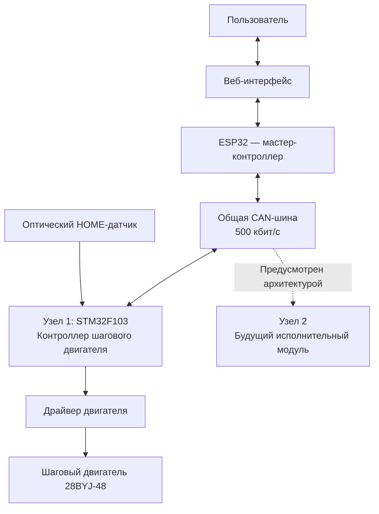

# Распределенная система управления устройствами по CAN

Мастер-контроллер на ESP32 с веб-интерфейсом для управления несколькими исполнительными устройствами через общую CAN-шину. 

## Идея проекта

Цель проекта — разработать модульную систему, в которой один мастер-контроллер управляет несколькими независимыми устройствами по CAN.

Мастер принимает команды пользователя через веб-интерфейс, адресует их нужному узлу и получает от него информацию о состоянии и результатах выполнения операций.

Каждый узел имеет собственный микроконтроллер и локально управляет подключённым оборудованием или собирает и обрабатывает данные с датчиков. 

## Архитектура системы

## Реализованные возможности

### Мастер-контроллер ESP32

- Подключение к Wi-Fi.
- Веб-интерфейс для управления исполнительными устройствами через браузер и просмотра телеметрии.
- Передача команд по CAN с адресацией исполнительного узла через идентификатор кадра.
- Приём ответов от узлов CAN и обработка телеметрии.
- Отображение состояния контроллера и текущей позиции.
- Автоматическая последовательность перемещений с переходом к следующей команде после завершения предыдущей.

### Исполнительный узел №1 - контроллер шагового двигателя на STM32

- Локальное управление шаговым двигателем.
- Поиск начального положения(HOME) по оптическому концевику (фотопрерывателю).
- Перемещение каретки в заданную позицию.
- Ограничение допустимого диапазона и скорости перемещения.
- Остановка движения по команде STOP.
- Обработка состояний контроллера, включая ошибки.
- Передача статуса выполнения команды и текущей позиции по CAN.

## Демонстрация текущей реализации

[Ссылка на видео работы системы](VIDEO_LINK)

## Фотографии

- Общий вид установки: `docs/images/setup.jpg`
- Веб-интерфейс: `docs/images/web-interface.jpg`
- Схема соединений: `docs/wiring-diagram.png`

## CAN-протокол

Используется CAN с номинальной скоростью 500 кбит/с и стандартными 11-битными идентификаторами кадров.

### Адресация узлов

| CAN ID | Назначение |
|---|---|
| `0x201` | Команды исполнительному узлу № 1 |
| `0x202` | Предусмотренный адрес команд узлу № 2 |
| `0x301` | Ответы узла № 1 |
| `0x302` | Предусмотренный адрес ответов узла № 2 |

Идентификаторы формируются на основе базового адреса и идентификатора узла. Это позволяет адресовать несколько устройств в рамках единой схемы обмена.

### Формат команды

Команда содержит 6 байт данных:

| Байты | Содержимое |
|---|---|
| 0 | Номер транзакции |
| 1 | Код команды |
| 2–5 | Параметр позиции в миллиметрах, Big Endian |

Используемые коды команд:

| Код | Операция |
|---|---|
| `0x01` | HOME — поиск нулевой позиции |
| `0x02` | GOTO — перемещение в заданную позицию |
| `0x03` | STOP — остановка движения |

### Формат ответа

Ответ содержит 7 байт данных:

| Байты | Содержимое |
|---|---|
| 0 | Номер исходной транзакции |
| 1 | Статус выполнения операции |
| 2 | Состояние контроллера |
| 3–6 | Текущая позиция в миллиметрах, Big Endian |

Статусы транзакции:
- `0xAA` — ACK, команда принята к выполнению;
- `0xFF` — NACK, команда отклонена или выполнение завершилось ошибкой;
- `0x55` — DONE, операция завершена.

Состояние контроллера и статус транзакции передаются отдельно: первое описывает состояние исполнительного узла, второе — результат выполнения конкретной команды.

## Аппаратная часть

| Компонент | Назначение |
|---|---|
| ESP32 | Мастер-контроллер, Wi-Fi и веб-интерфейс |
| STM32F103 Blue Pill | Исполнительный контроллер |
| 28BYJ-48 | Шаговый двигатель |
| Драйвер шагового двигателя | Управление обмотками двигателя |
| Оптический датчик(фотопрерыватель)  | Определение HOME |
| CAN-трансиверы | Физический интерфейс CAN |
| USB-адаптер питания 5 В | Питание установки |

Точные модели CAN-трансиверов, драйвера и датчика, а также полная распиновка приведены в отдельной схеме подключения.

## Программная структура

### ESP32 — ESP-IDF / C++

- `components/can_master/` — инициализация TWAI, передача команд и приём CAN-кадров.
- `components/device_manager/` — управление устройствами, обработка команд и автоматических последовательностей.
- `components/web_server/` — HTTP/WebSocket-интерфейс и обмен данными с браузером.
- `components/wifi_manager/` — подключение к Wi-Fi.
- `storage/` — HTML, CSS и JavaScript веб-интерфейса.
- `main/` — инициализация приложения.

### STM32 — C / STM32 HAL

- `Core/Src/motion.c` — управление движением, позиционирование и состояния контроллера.
- `Core/Src/can_network.c` — фильтрация, приём команд и отправка ответов по CAN.
- `Core/Src/main.c` — инициализация периферии и основной цикл.
- `Core/Src/tim.c` и `Core/Src/gpio.c` — конфигурация таймеров и GPIO.

## Инструменты и технологии использованые для разработки

### Мастер-контроллер ESP32

- Стек: ESP32 NodeMCU, VS Code, ESP-IDF,  + 
- Язык: C++

### Контроллер шагового двигателя на STM32

- Стек: STM32F103C8T6, VS Code, OpenO
- Язык: C

## Ограничения текущей версии

- Физически реализован один исполнительный узел — шаговый привод.
- Дополнительные узлы предусмотрены архитектурой, но ещё не реализованы полностью.
- Панель актуатора в веб-интерфейсе является заготовкой интерфейса и не подтверждает работоспособность отдельного CAN-узла.
- Установка собрана как экспериментальный прототип из готовых модулей и соединительных проводов.
- Перед использованием в реальном оборудовании требуется дополнительная проверка обработки ошибок, потери связи и безопасных состояний.

## Дальнейшее развитие

- Подключение последующих узлов по CAN (например, контроллер DC-мотора, контроллер мониторинга состояния оборудования, контроллер безопасности рабочего пространства).
- Унификация протокола обмена и управления устройствами.
- Улучшение диагностики ошибок и обработки потери связи.
- Развитие механической части и повышение надёжности соединений.
- Расширение автоматических сценариев управления.

