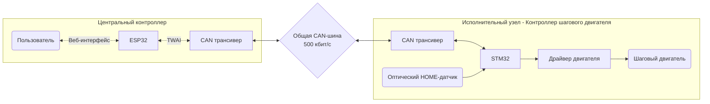

# Распределенная система управления устройствами по CAN. Версия 1.0

## Цель проекта

Разработать модульную систему управления несколькими независимыми устройствами через общую CAN-шину.

Каждый узел имеет собственный микроконтроллер и локально управляет подключенным оборудованием, обрабатывает данные с датчиков, принимает команды от других узлов и отправляет текущее состояние. 

Через веб-интерфейс центрального контроллера оператор имеет возможность управлять любым узлом и видеть его состояние в данный момент.

## Текущая реализация

Реализован прототип системы с центральным контроллером на ESP32 и одним исполнительным узлом на STM32 

Центральный контроллер предоставляет веб-интерфейс для ввода команд оператором, передаёт их по CAN и получает ответ от исполнителя. 

Исполнительный узел - контроллер шагового двигателя. Принимает команду, управляет шаговым двигателем (перемещает каретку в расчетную координату в мм) и отправляет мастеру результат операции.

**ФОТО УСТАНОВКИ**

[Ссылка на видео работы системы](VIDEO_LINK)

#### Архитектура системы

#### Принцип работы

Описать какие кнопки и что умеет делать. Про поиск нуля

1. Оператор отправляет команду из браузера по WebSocket в формате JSON.
2. Оператор отправляет команду из браузера по WebSocket в формате JSON.
3. ESP32 разбирает сообщение и передаёт команду в `DeviceManager`.
4. `CanMaster` формирует стандартный CAN-кадр с идентификатором адресуемого узла и 8-битным token команды.
5. STM32 принимает кадры с ID `0x201`, передаёт команду в основной цикл и запускает соответствующую операцию.
6. STM32 отправляет статус и координату по CAN. ESP32 обновляет данные узла и пересылает телеметрию подключённым WebSocket-клиентам.
7. Во время автоматической последовательности ESP32 переходит к следующей точке после `DONE`, если token совпадает с ожидаемым. При `NACK` последовательность останавливается.

Внутренняя прошивка STM32 использует состояния `STARTUP`, `UNHOMED`, `HOMING`, `READY`, `MOVING` и `FAULT`.

- После инициализации привод находится в `UNHOMED`; команды по перемещению к заданной координате отклоняются, т.к. еще не определено нулевое положение HOME.
- Команда `HOME` запускает движение к оптическому датчику. Контроллер переходит в состояние `HOMING`. По достижении датчика координата устанавливается в ноль и контроллер переходит в состояние `READY`.
- Команда `GOTO` задаёт целевую координату. 
- По достижении расчётной цели контроллер возвращает `DONE`.
- Выход за заданный диапазон в текущем коде приводит к `NACK` и состоянию `FAULT`.
- Команда `STOP` реализована для остановки движения.

## Центральный контроллер на ESP32

**Скриншот веб-интерфейса**

Логика работы заключается в 4 основных функциях:

1) **Раздача HMI-интерфейса.**
   
   При вводе IP-адреса платы в браузере, ESP32 считывает файлы интерфейса (`index.html`, `style.css`, `app.js`) со своей внутренней флеш-памяти (`LittleFS/SPIFFS`) и отправляет их клиенту по протоколу HTTP. Браузер отрисовывает панель и открывает дуплексный канал WebSocket.

2) **Приём и парсинг команд.**

   Когда оператор задает команду через кнопки на сайте, браузер отправляет на ESP32 текстовую строку в формате JSON. WebSocket-сервер (`WebServer.cpp`) получает этот текст, парсит через библиотеку cJSON и передаёт параметры в блок управления узлами `DeviceManager.cpp`.

3) **Блок управления узлами.**
   
   Работа с последовательностью перемещений (например: 20 -> 60 -> 15 мм) происходит по событийной модели (Event-Driven):
    - Программа берет координату из массива, составляет и отправляет кадр в шину CAN.
    - Как только исполнитель (STM32) физически доезжает до точки, он присылает в CAN кадр DONE (0x55). ESP32 обрабатывает это событие и отправляет следующую координату.

4) **Прием телеметрии.**

   Каждые 50 мс ESP32 принимает по CAN пакеты с текущим расчетным положением каретки от STM32, переводит эти данные в JSON и отправляет по Wi-Fi, обновляя цифры на экранах в реальном времени.

#### Программная структура

- `components/can_master/` — инициализация TWAI, передача команд и приём CAN-кадров.
- `components/device_manager/` — управление устройствами, обработка команд и автоматических последовательностей.
- `components/web_server/` — HTTP/WebSocket-интерфейс и обмен данными с браузером.
- `components/wifi_manager/` — подключение к Wi-Fi.
- `storage/` — HTML, CSS и JavaScript веб-интерфейса.
- `main/` — инициализация приложения.

#### Аппаратная часть

| Компонент | Назначение |
|--|------|
| ESP32 NodeMCU | Мастер-контроллер, Wi-Fi и веб-интерфейс |
| CAN-трансивер WVCMCU-230 на базе SN65HVD230| Физический интерфейс CAN |
| USB-адаптер питания 5 В | Питание установки |

Схема соединений: `docs/wiring-diagram.png`

 

## Исполнительный узел - контроллер шагового двигателя на STM32

Логика работы разделена на 3 основных процесса:

1) Аппаратный приём и фильтрация CAN

   STM32 находится в режиме аппаратной фильтрации - просыпается только при обнаружении кадров с ID: 0x201 (команда от центрального контроллера).
   Обработчик прерывания расшифровывает и сохраняет токен поступившей команды, код операции и цель в миллиметрах.

2) Конечный автомат (FSM)
В любой момент времени контроллер может находиться только в одном из следующих состояний:
     - STARTUP (инициализация),
     - UNHOMED (контроллер не откалиброван (положение 0 мм неизвестно), ход заблокирован),
     - HOMING (движение с пониженной скоростью в сторону концевика(фотопрерывателя)),
     - READY (ожидание команд, устройство откалибровано),
     - MOVING (выполнение команды),
     - FAULT (авария).
   
Перед любым действием модуль `motion.c` проверяет текущее состояние системы. 
Если система находится в состоянии `UNHOMED`, любые команды перемещения отклоняются и возвращается отказ `NACK` (0xFF).
Команда исполняется только после успешного прохождения калибровки нуля (`HOMING`) и перехода привода в статус готовности `READY`.

3) Движение каретки рассчитывается внутри аппаратного прерывания таймера `TIM2`:
     - Прерывание пошагово рассчитывает трапецию скорости (линейный разгон, марш, линейное торможение). Чтобы разгрузить процессор, все вычисления переведены на целые числа.
     - Скорость регулируется изменением регистра таймера `__HAL_TIM_SET_AUTORELOAD`. При достижении целевой точки таймер останавливается, формируется пакет `DONE` (0x55) и отправляется по CAN мастер-контроллеру.

- Схема соединений: `docs/wiring-diagram.png`
- Стек: C, STM32F103C8T6, STMCubeMX, VS Code, CMake, Ninja, OpenOCD, Cortex-Debug

Алгоритм движения выполняет поиск нулевой точки по датчику HOME и рассчитывает движение по числу шагов. Для перемещений используется изменение периода TIM2 с участками разгона, движения и торможения. Коэффициент настройки механики — 44.15 шага/мм, программный диапазон координат — 0…170 мм.
Важно: координата в телеметрии является расчётной — она получена из числа выполненных шагов относительно HOME. У двигателя нет энкодера обратной связи по положению, поэтому контроллер не может независимо подтвердить фактическое положение каретки при пропуске шагов или механическом проскальзывании.

#### Программная структура

- `Core/Src/motion.c` — управление движением, позиционирование и состояния контроллера.
- `Core/Src/can_network.c` — фильтрация, приём команд и отправка ответов по CAN.
- `Core/Src/main.c` — инициализация периферии и основной цикл.
- `Core/Src/tim.c` и `Core/Src/gpio.c` — конфигурация таймеров и GPIO.

#### Аппаратная часть

| Компонент | Назначение |
|--|-------|
| STM32F103 Blue Pill | Исполнительный контроллер |
| Шаговый двигатель 28BYJ-48 | Перемещение каретки |
| Драйвер шагового двигателя на базе ULN2003 | Управление обмотками двигателя |
| Оптический датчик(фотопрерыватель) ITR9606 | Определение HOME |
| CAN-трансивер WVCMCU-230 на базе SN65HVD230 | Физический интерфейс CAN |
| USB-адаптер питания 5 В | Питание установки |

 

## CAN-протокол

Используется CAN с номинальной скоростью 500 кбит/с и стандартными 11-битными идентификаторами кадров. 

#### Адресация

Идентификаторы кадра формируются на основе базового адреса и идентификатора узла. Это позволяет адресовать несколько устройств в рамках единой схемы обмена.

| Назначение кадра | Формула | Для Узла №1 | Для будущего Узла №2 
|---|---|---|----|
| Команда от мастера к узлу | `0x200 + Node_ID` | `0x201` | `0x202` |
| Ответ узла мастеру | `0x300 + Node_ID` | `0x301` | `0x302` |

#### Структура кадра команды (Мастер -> Исполнитель). Команда содержит 6 байт данных

| Элемент кадра | Расшифровка |
|---|---|
| CAN ID   | `0x200 + Node_ID`                                                        |
| Байт 0   | `Токен`                                                                  |
| Байт 1   | Код команды (`0x01` = HOME, `0x02` = GOTO, `0x03` = STOP)               |
| Байт 2-5 | Целевая координата в миллиметрах (32-bit `int32_t` в формате Big Endian) |

 

#### Структура кадра ответа (Исполнитель -> Мастер). Ответ содержит 7 байт данных

| Элемент кадра | Расшифровка |
|---|---|
| CAN ID   | `0x300 + Node_ID` |
| Байт 0   | `Токен`  |
| Байт 1   | Статус транзакции (`0xAA` = ACK / Принято, `0xFF` = NACK / Отклонено, `0x55` = DONE / Успешно завершено) |
| Байт 2   | Физическое состояние автомата привода (`0x01` = MOVING, `0x02` = READY, `0x03` = FAULT, `0x04` = UNHOMED) |
| Байт 3-6 | Текущая физическая координата каретки в мм (Big Endian) |

 

#### Пример

Команда: `Переместить каретку Узла 1 на координату 170 мм`

| Значение (Hex) | Байт | Расшифровка | 
|---|---|---|
| 0x201 | CAN ID | База для адресации команд это 0x200. У контроллера шагового двигателя ID=1
| 0x05 | Байт 0 | Токен 
| 0x02 | Байт 1 | Код команды GOTO 
| 0x00 | Байт 2 | Координата: Старший байт 4 (Big Endian)
| 0x00 | Байт 3 | Координата: Байт 3
| 0x00 | Байт 4 | Координата: Байт 2
| 0xAA | Байт 5 | Координата: Младший байт 1 (0xAA = 170 мм)

 

Ответ: `Успешно выполнена. Текущее состояние READY. Расчетная позиция каретки 170 мм`

| Значение (Hex) | Байт | Расшифровка | 
|---|---|---|
0x301 | CAN ID | База для адресации ответов это 0x200. У контроллера шагового двигателя ID=1
0x05 | Байт 0 | Токен
0x55 | Байт 1 | Статус транзакции DONE
0x02 | Байт 2 | Состояние READY 
0x00 | Байт 3 | Реальная позиция: Старший байт 4 (Big Endian)
0x00 | Байт 4 | Реальная позиция: Байт 3
0x00 | Байт 5 | Реальная позиция: Байт 2
0xAA | Байт 6 | Реальная позиция: Младший байт 1 (Каретка стоит в расчётной координате 170 мм)

 

## Планируемые узлы 

- Узел №2 - контроллер DC-мотора с обратной связью через энкодер
- Узел №3 - контроллер мониторинга состояния оборудования
- Узел №4 - контроллер безопасности рабочего пространства
-  ...

 

## Ограничения текущей версии

- Физически реализован только один исполнительный узел — шаговый привод. Дополнительные узлы предусмотрены архитектурой, но ещё не реализованы полностью.
- Установка собрана как демонстрационный прототип. Перед использованием в реальном оборудовании требуется дополнительная проверка обработки ошибок, потери связи и безопасных состояний.
- Программный диапазон в текущей конфигурации — 0–170 мм.
- Программные пределы и датчик HOME не заменяют промышленную систему безопасности.
- У прототипа нет независимой обратной связи по положению и полноценной диагностики механического заклинивания.

## Дальнейшее развитие

- Подключение последующих узлов по CAN.
- Унификация протокола обмена и управления устройствами.
- Улучшение диагностики ошибок и обработки потери связи.
- Развитие механической части и повышение надёжности соединений.
- Расширение автоматических сценариев управления.
- В текущую реализацию CAN протокола заложена возможность отправлять команды и получать ответы от нескольких устройств.

